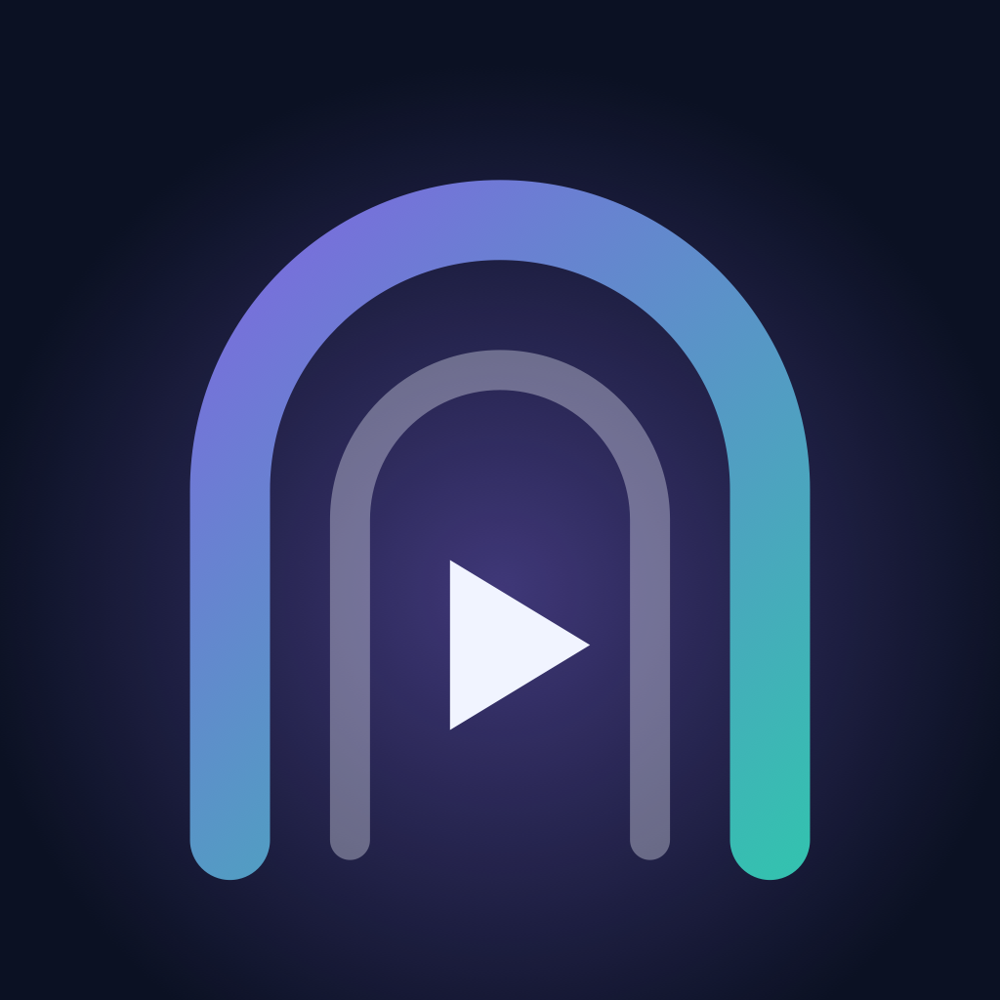
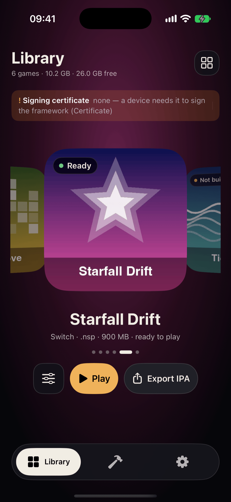
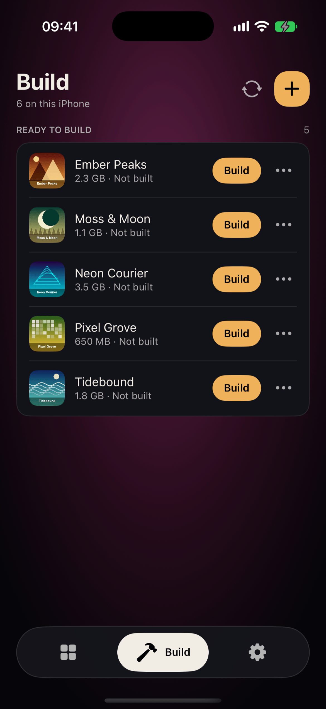
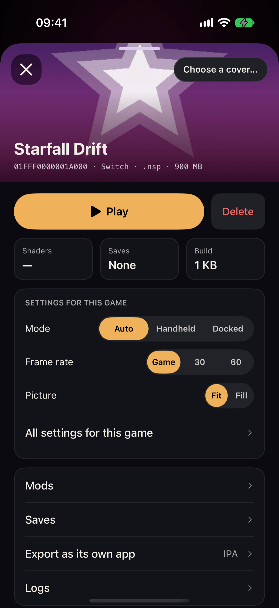
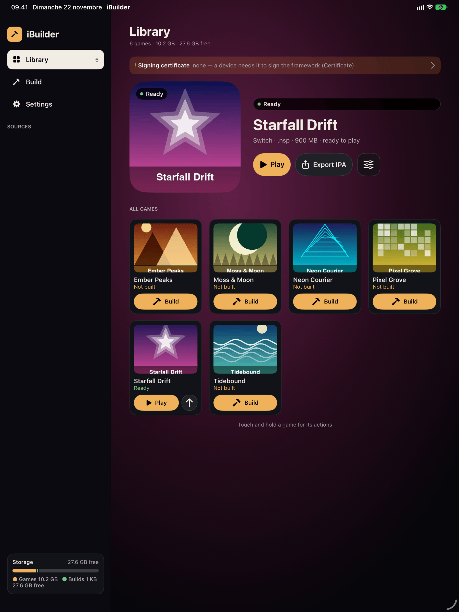

<h1 align="center">
  <br>
  iBuilder
</h1>

<p align="center"><b>Build the Switch games you own into a native iOS app, on the iPhone itself.</b></p>

<p align="center">
  <a href="https://github.com/Absenti/iBuilder/actions/workflows/ci.yml"></a>
  <a href="https://github.com/Absenti/iBuilder/releases/latest"></a>
  <a href="LICENSE"></a>
</p>

> [!WARNING]
> **No games, no keys, no firmware are provided**, and the app never downloads any.
> Use iBuilder **only with games you own**, dumped from your own console, with the **keys dumped from your own console** (`prod.keys`).
> iBuilder is **not affiliated with, authorised or endorsed by Nintendo** (or Apple). It is for **personal and educational use**; piracy is not supported.
> What you build and run is your responsibility, under the law of your country.

## What it does

iBuilder takes a game dump (`.nsp`, `.xci`, `.nsz`, or `.nup` for Switch 2) and turns it into a native iOS build **on the phone**:
it extracts the game, derives its profile, rewrites its ARM64 modules, translates its shaders to Metal, assembles and signs a framework, and boots it with the
[nxnative](https://github.com/seedds/nxnative) engine. No Mac, no PC, no cable once the app is installed. The build chain is written in Rust (no Python on the phone).

Experimental: results differ per game, and some features are verified on a few games only.

## Screenshots

<p align="center">
  
  
  
  
</p>

## Install with SideStore

Add the source, then install iBuilder from it:

* on the phone, tap **[Add to SideStore](sidestore://source?url=https://raw.githubusercontent.com/Absenti/iBuilder/main/apps.json)**
  (`sidestore://source?url=https://raw.githubusercontent.com/Absenti/iBuilder/main/apps.json`), or
* in SideStore (or AltStore), **Sources > +**, and paste `https://raw.githubusercontent.com/Absenti/iBuilder/main/apps.json`.

The IPA is also on the [Releases](https://github.com/Absenti/iBuilder/releases) page with its sha256. Every release IPA is checked by CI before it is listed
([docs/BUILDING.md](docs/BUILDING.md#releasing-and-the-sidestore--altstore-source)).

**Bundle id:** `dev.ibuilder.app`. It installs as a **new** app: an older install (`dev.nxpocket.gameapp`) is left as it is; copy your games and saves across with the Files app
(On My iPhone > iBuilder) before deleting it. The app asks for the increased-memory-limit entitlement; it applies only if your installer's provisioning profile carries it too.

## What you need

* An iPhone or iPad (tested on iOS 27; minimum iOS 26). A GPU without BC textures (an iPhone before the A17 Pro, an iPad before the M1) works too:
  iBuilder decodes the textures on the CPU, which is slower and uses more memory (Settings › This iPhone says so).
* Your game: `.nsp`, `.xci`, `.nsz` (Switch) or `.nup` (Switch 2).
* `prod.keys` from your own console (not needed for a `.nup`).
* Optional: your signing certificate (`.p12` and its password), needed only to **play inside iBuilder**. Without it a build is signed ad hoc
  for export: export the IPA and install it as its own app. Imported later, the game's settings offer **Sign again to play** (no rebuild).

An exported IPA is not installable as is: iOS installs only signed apps, so install it with a signing tool (SideStore / AltStore, Sideloadly or Xcode with an Apple ID,
a paid developer account, or a distribution-certificate provider), which re-signs it. Exporting without a `.p12` only removes the need to import a certificate into iBuilder.

## Which certificate did you install iBuilder with?

| | **Development** certificate (e.g. a free Apple ID through SideStore) | **Distribution** certificate (e.g. FlareStore) |
|---|---|---|
| Play inside iBuilder | **Yes**, with your `.p12` imported: iOS lets the app load the code it generates. | **No**: iOS refuses to load that code from the app's storage. |
| The `.p12` | Needed to play inside iBuilder (a build without it is for export only). | Not needed: the installer re-signs the exported IPA. |
| Export an IPA | Optional. | **Required**: build the game, export the full IPA, install it as its own app. |
| First start | Runs in iBuilder with its shader cache. | The exported app starts with an empty shader cache (below). |

## First start: shader preparation

The shaders are translated during the build, but Metal still has to compile them, and Apple's offline Metal compiler exists only on macOS.
So the first start of a game (and of every exported app, which has its own Metal cache) **prepares the shaders once, on the phone**, with a progress bar.
It can take a few minutes for a large game; it does not repeat on later launches. Keep the phone awake and cool meanwhile.

## Using it

1. Open iBuilder, import `prod.keys` (the Library shows what is still missing) and, to play inside iBuilder, your certificate.
2. Add a game (Build tab **+**, or share it to iBuilder from the Files app) and start the build. It can be paused, resumed or cancelled.
3. Play, or export the IPA, depending on your certificate (table above).

A bug? Open an issue with the app's diagnostics ([docs/DIAGNOSTICS.md](docs/DIAGNOSTICS.md)), after removing personal information.

## Build it yourself

```bash
cargo build --release --workspace     # the Rust chain (macOS)
scripts/test-report.sh                # the test suite, with the count of skipped fixture tests
scripts/build-app.sh device           # the app IPA (needs Xcode, the .NET iOS workload and the inputs below)
```

Building the IPA needs inputs that are not in this repository (the prebuilt engine host and the signing/zstd/SPIRV-Cross sources).
See [CONTRIBUTING.md](CONTRIBUTING.md), [docs/ARCHITECTURE.md](docs/ARCHITECTURE.md) and the index [docs/README.md](docs/README.md).
A build made with the default settings embeds stand-in fonts derived from macOS's: keep it for yourself and never share it ([NOTICE.md](NOTICE.md)).

## Credits

* [nxnative](https://github.com/seedds/nxnative) by seedds (MIT): the emulation engine iBuilder drives. This repository holds only patches against a pinned version.
* [NX2Apple](https://github.com/LNPANDY/NX2Apple) by LNPANDY and contributors (MIT): the patch queue the pinned engine tree carries.
* LibHac, Ryujinx's shader translator, zsign, SPIRV-Cross, zstd, the .NET runtime and others: see [NOTICE.md](NOTICE.md) for every component and its license.

"Nintendo" and "Switch" are trademarks of Nintendo.

## License

iBuilder's own code is under the [MIT license](LICENSE). Third-party components keep their own licenses ([NOTICE.md](NOTICE.md)).
Contributing: [CONTRIBUTING.md](CONTRIBUTING.md). Security: [SECURITY.md](SECURITY.md).
